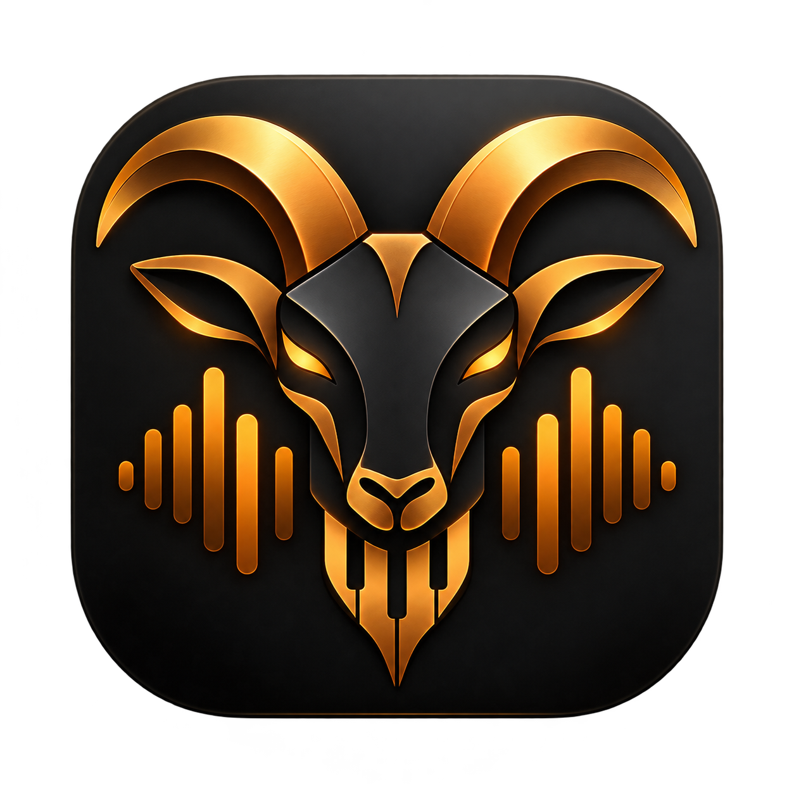
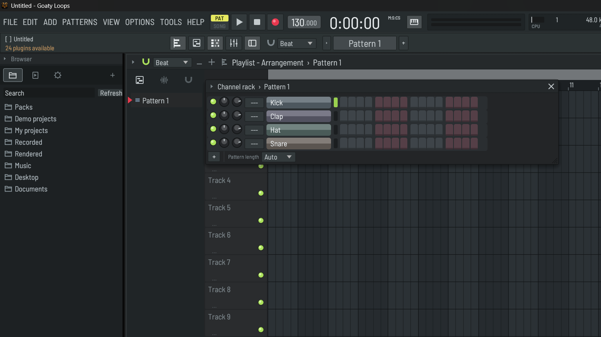

<p align="center">
  
</p>

<h1 align="center">Goaty Loops</h1>

<p align="center">
  A free, open-source, pattern-based music studio for Windows, written in Rust.<br>
  Make beats, arrange songs, mix and master, with VST3 plugins and low-latency audio.
</p>

<p align="center">
  <a href="https://github.com/HamzaBaghdadi/goaty-loops/releases/latest"></a>
  <a href="LICENSE"></a>
  
</p>

<p align="center">
  
</p>

> **Not affiliated with Image-Line.** Goaty Loops is an independent project. It is not
> affiliated with, endorsed by or sponsored by Image-Line Software. "FL Studio" is a
> trademark of Image-Line Software and is used here only to describe file compatibility.
> Goaty Loops contains no Image-Line code, plugins, samples or artwork.

## Download

1. Get **`goaty-loops.exe`** (or the `.zip`) from the [latest release](https://github.com/HamzaBaghdadi/goaty-loops/releases/latest).
2. Put it in a folder you own, e.g. `Documents\Goaty Loops`, and run it. No installer needed.

Windows SmartScreen may warn that the app is unrecognized because builds aren't code-signed
yet: choose **More info → Run anyway**.

### Updates

Goaty Loops checks GitHub for a new release when it starts (turn this off in the update
window) and under **Help → Check for updates**. Updates are downloaded from this repository's
releases, verified against GitHub's SHA-256 checksum, and installed in place; restart to use the
new version.

## Features

| Area | What you get |
|---|---|
| Channel rack | Step sequencer, mute/solo, pan/volume, mixer routing, activity meters, mini piano-roll preview |
| Piano roll | Notes with snap, quantize, chop, glue, legato, velocity lane, ghost notes, computer-keyboard piano |
| Playlist | Pattern, audio and automation clips, splitting and trimming, time and signature markers, song mode |
| Mixer | Master + up to 127 inserts, sends and sidechain routing, effect chains, plugin delay compensation, multi-core processing |
| Instruments | Sampler (WAV/MP3/OGG/FLAC/AIFF/M4A, time-stretch, reverse, ADSR), Goaty Synth, Goaty Drum, VST3 instruments |
| Effects | Parametric EQ, limiter, compressor, two reverbs, delay, filters, distortion, stereo tools, soft clipper, loudener, VST3 effects |
| Recording | MIDI keyboard input and recording, MIDI learn, audio recording with input monitoring |
| Audio | Windows shared, **low-latency** and **exclusive (WASAPI)** drivers: about 6 ms output latency on a typical laptop |
| Export | WAV, FLAC and per-track stems |
| Safety | Autosave, crash recovery and crash reports, atomic saves, "save changes?" prompts |
| Files | Native `.goaty` projects; opens and saves `.flp` project files |

### Opening `.flp` projects

`.flp` files are read using the format as documented by the community
(see [PyFLP](https://github.com/demberto/PyFLP)), for interoperability. On import Goaty Loops restores:

- tempo, time signature, title/artist/genre/comments
- channels: name, colour, volume, pan, mute, mixer routing, sample paths
- patterns with all notes, and the playlist arrangement
- mixer inserts, sends and sidechains, with common native effects rebuilt as Goaty Loops effects
- third-party VST3 plugins (with their saved settings), mapped to your installed copies
- automation clips for volume, pan, effect and VST3 parameters, tempo and main volume

Instruments whose state is a closed, proprietary format can't be read; those channels open
with Goaty Synth as a stand-in and the import report lists them.

## Privacy

Goaty Loops has no accounts, telemetry or analytics. The only network request it makes is the
update check to the GitHub Releases API (which you can turn off). Settings, autosaves and crash
reports stay on your computer in `%APPDATA%\Goaty Loops`.

## Building from source

Requires Rust 1.80+.

```sh
cargo run --release              # start the app
cargo run --release -- song.flp  # open a project directly
cargo test --workspace           # run the test suite
```

**Windows + GNU toolchain without a full MinGW install:**
- `Cargo.lock` pins `parking_lot_core` (0.9.10) and `libloading` (0.8.6) to versions that
  don't need `dlltool`. Don't run a blanket `cargo update` without re-checking this.
- `crates/app/build.rs` generates import libraries that rustup's bundled MinGW lacks
  (currently `shlwapi`) using the toolchain's own `rust-lld`, and embeds the app icon.
- If you add dependencies and see `error calling dlltool` or `cannot find -l...`, either
  switch to the MSVC toolchain (`rustup default stable-x86_64-pc-windows-msvc`, which needs
  the Visual Studio Build Tools) or install MinGW-w64.

### Releasing

Bump `version` in the root `Cargo.toml`, write `RELEASE_NOTES.md`, then push a tag:

```sh
git tag v0.2.0 && git push origin v0.2.0
```

The [release workflow](.github/workflows/release.yml) builds `goaty-loops.exe` and publishes
the GitHub release that the in-app updater picks up.

## Architecture

```
crates/
  flp/      goaty-flp     .flp reader/writer: lossless event stream + typed project model
  engine/   goaty-engine  project model, sequencer, instruments, effects, mixer, real-time audio
                          (cpal; WASAPI low-latency and exclusive on Windows), offline export
  app/      goaty-loops   egui/eframe GUI, autosave and recovery, updater
```

- The UI owns the `Project`. After an edit it publishes an immutable snapshot through
  `ArcSwap`, which the audio thread picks up lock-free at the next buffer. Replaced
  snapshots go back to the UI thread to be freed, so the audio thread never deallocates
  or tears down plugins.
- The renderer schedules notes with sample accuracy inside 512-sample blocks, runs each
  routing level of the mixer in parallel on a parking worker pool, and skips tracks that
  have been silent for a while (smart disable).
- The same renderer drives offline export, so exports match playback.

Keyboard shortcuts are listed under *Help → Keyboard shortcuts*. See
[ROADMAP.md](ROADMAP.md) for what comes next.

## License

Copyright 2026 Hamza Baghdadi. Licensed under the [Apache License, Version 2.0](LICENSE).
The bundled Barlow fonts are under the [SIL Open Font License](crates/app/assets/fonts/OFL.txt).
See [NOTICE](NOTICE) for trademark information.
